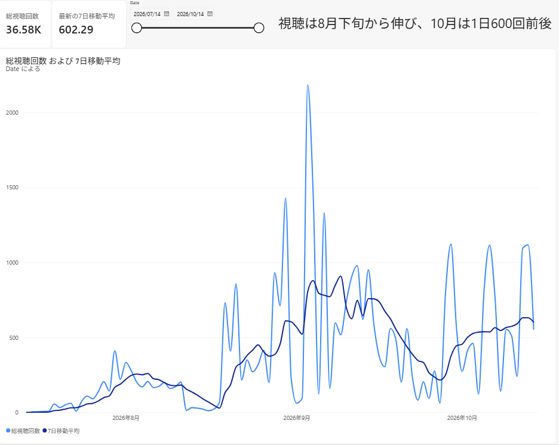
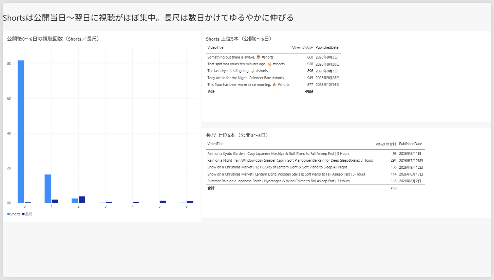

# YouTube チャンネル分析（SQL Server × Power BI × pandas）

自分で運営している睡眠用BGMチャンネルの YouTube Studio データ（2026/7/14〜10/14、動画342本）を、SQL Server・Power BI・pandas の3つで分析しました。

## わかったこと
- 仮説：「Shorts は入口、長尺は本体」
  - 1本あたりの視聴回数は Shorts 157.4回、長尺 32.4回
  - Shorts は公開当日に1本あたり約680回見られて、すぐに止まる。長尺は2日目以降に少しずつ伸びる
- 視聴は8月下旬から伸び、10/14 の7日移動平均は 602.29回

## 使った技術
- SQL Server：整形ビュー、ウィンドウ関数（`AVG() OVER` の7日移動平均、`RANK()` の種類別上位5本）
- Power BI：Power Query、DAX、日付テーブル
- pandas（Google Colab）：`rolling`、`merge`、`groupby().head()`、matplotlib

## 答え合わせ
同じ数字を3つの道具で出して、一致することを確かめました（詳しくは `docs/`）。

| 項目 | SQL | Power BI | pandas |
|---|---|---|---|
| 日別の行数・合計 | 91日・36,577回 | 同じ | 同じ |
| 10/14 の7日移動平均 | 602.29 | 602.29 | 602.29 |
| 1本あたり（Shorts／長尺） | 157.4／32.4 | 同じ | 同じ |
| 公開7日間の上位5本 | 一致 | 一致 | 一致 |

## データの差の扱い
日別の合計（36,577回）と動画別の合計（36,474回）は103回（1日約1回・全体の0.3%）違います。期間中に削除した動画の分と判断し、全体の推移は日別、動画・種類別の比較は動画一覧と使い分けました。

## フォルダ
- `sql/`：整形ビュー、クエリ3本、上位5本の RANK クエリ
- `python/`：pandas で再現したノートブック
- `docs/`：答え合わせのメモ、SQL と pandas の対応表
- `images/`：Power BI と pandas の画面

元の CSV は入れていません。
